<!-- Cabeçalho animado -->
<p align="center">
  
</p>

<p align="center">
  <a href="https://portfolio-guilherme-silvestrini.netlify.app/">
    
  </a>
</p>

<p align="center">
  <a href="https://portfolio-guilherme-silvestrini.netlify.app/"></a>
  <a href="https://www.linkedin.com/in/guilherme-silvestrini-782226233/"></a>
  <a href="mailto:contatosilvestrini@gmail.com"></a>
  
</p>

<p align="center">
  
</p>

## 👨‍💻 Sobre mim

```ts
const guilherme = {
  local: "Brasil 🇧🇷",
  papel: "Desenvolvedor full stack + suporte e infraestrutura de TI",
  foco: ["sistemas de gestão", "interfaces responsivas", "automação de processos"],
  agora: ["apps de desktop em C# / .NET", "bots e integrações", "homelab com Docker"],
  gosto: "entender o problema de quem usa e entregar algo simples que funciona",
};
```

- 🧩 Do **front ao servidor**: interface em React, API em Node.js, banco, deploy com Docker e nginx.
- 🤖 Automatizo o dia a dia com **bots** (Discord e WhatsApp), scripts e integrações.
- 🖥️ Mantenho minha própria infraestrutura: **VPS Linux, servidor doméstico, VPN e backups automáticos**.
- 🎮 Nas horas vagas, transformo hobbies em projetos — jogos no navegador, ferramentas para games e plugins de Minecraft.

## 🛠️ Tecnologias

<p align="center">
  <br/>
  <br/>
  
</p>

## 🚀 Projetos em destaque

<table>
  <tr>
    <td width="50%" valign="top">
      <h3>🎯 <a href="https://github.com/devsilvver/analisador-lol">Analisador LoL</a></h3>
      <p>Assistente leve para League of Legends, em português: sugestões de campeões, counters, runas, builds e acompanhamento da partida em tempo real.</p>
      <p>
        
        
        
      </p>
      <a href="https://github.com/devsilvver/analisador-lol/releases/latest"></a>
    </td>
    <td width="50%" valign="top">
      <h3>🧹 <a href="https://github.com/devsilvver/desinstalador">Desinstalador Completo</a></h3>
      <p>Remove programas do Windows e todos os resquícios — pastas, registro, atalhos e serviços — com revisão antes de excluir qualquer coisa.</p>
      <p>
        
        
        
      </p>
      <a href="https://github.com/devsilvver/desinstalador/releases/latest"></a>
    </td>
  </tr>
  <tr>
    <td width="50%" valign="top">
      <h3>🌐 <a href="https://github.com/devsilvver/meu-portfolio">Meu portfólio</a></h3>
      <p>Apresentação pessoal com projetos, habilidades e canais de contato.</p>
      <p>
        
        
        
      </p>
      <a href="https://portfolio-guilherme-silvestrini.netlify.app/"></a>
    </td>
    <td width="50%" valign="top">
      <h3>⚖️ <a href="https://github.com/devsilvver/landing-page-advogada">Landing page de advocacia</a></h3>
      <p>Página institucional responsiva com seções de serviços, depoimentos e contato.</p>
      <p>
        
        
        
      </p>
      <a href="https://lading-page-advocacia.netlify.app/"></a>
    </td>
  </tr>
  <tr>
    <td width="50%" valign="top">
      <h3>🛋️ <a href="https://github.com/devsilvver/site-de-venda-de-moveis">Estilo &amp; Conforto</a></h3>
      <p>Vitrine de móveis responsiva com interações no navegador.</p>
      <p>
        
        
        
      </p>
      <a href="https://venda-de-moveis.netlify.app/"></a>
    </td>
    <td width="50%" valign="top">
      <h3>💎 <a href="https://github.com/devsilvver/corrida-das-gemas">Corrida das Gemas</a></h3>
      <p>Estudo de tower defense com baralhos, fusão de unidades e multiplayer P2P.</p>
      <p>
        
        
        
      </p>
      
    </td>
  </tr>
</table>

## 🏗️ Nos bastidores

Boa parte do que construo é **código privado em uso real**. Alguns exemplos:

| | Sistema | O que faz | Stack |
|:-:|---|---|---|
| 🏢 | Plataforma para pequenos negócios | Catálogo, pedidos, financeiro e bot de WhatsApp próprio para cada loja | React · Node.js · PostgreSQL · Docker |
| 💰 | Gestor financeiro pessoal | Gastos registrados por mensagem, orçamento com alertas, metas e resumos automáticos | React · Node.js · SQLite · Docker |
| 🛰️ | Central de controle | Painel que monitora e opera servidores, apps e backups | Python · SSH · Docker |
| 🏷️ | Controle patrimonial | Inventário com QR Code, trilha de auditoria, relatórios PDF/Excel e login em duas etapas | React · Tailwind · Express · MySQL |
| 🎫 | Controle de chamados | Produtividade no suporte: metas diárias, calculadora de SLA e relatórios | React · TypeScript · Vite |
| ⛏️ | Servidores de Minecraft | Servidor Java + Bedrock com plugins próprios e backups diários | Java · Paper · Linux · systemd |
| 🏠 | Homelab | Servidor doméstico com mídia, VPN, DNS e automação residencial | Docker · Tailscale · Home Assistant |

> 💾 O **Gestor Financeiro Pessoal** para Windows tem instaladores e atualizações públicos em [gestor-financeiro-releases](https://github.com/devsilvver/gestor-financeiro-releases/releases).

## 🐍 Contribuições

<p align="center">
  <picture>
    <source media="(prefers-color-scheme: dark)" srcset="https://raw.githubusercontent.com/devsilvver/devsilvver/output/github-snake-dark.svg"/>
    <source media="(prefers-color-scheme: light)" srcset="https://raw.githubusercontent.com/devsilvver/devsilvver/output/github-snake.svg"/>
    
  </picture>
</p>

## 🤝 Vamos conversar?

Aberto a conversar sobre **desenvolvimento web, automação, sistemas de gestão** ou colaborar em um projeto.

<p align="center">
  <a href="https://www.linkedin.com/in/guilherme-silvestrini-782226233/"></a>
  <a href="mailto:contatosilvestrini@gmail.com"></a>
</p>

<!-- Rodapé animado -->
<p align="center">
  
</p>
